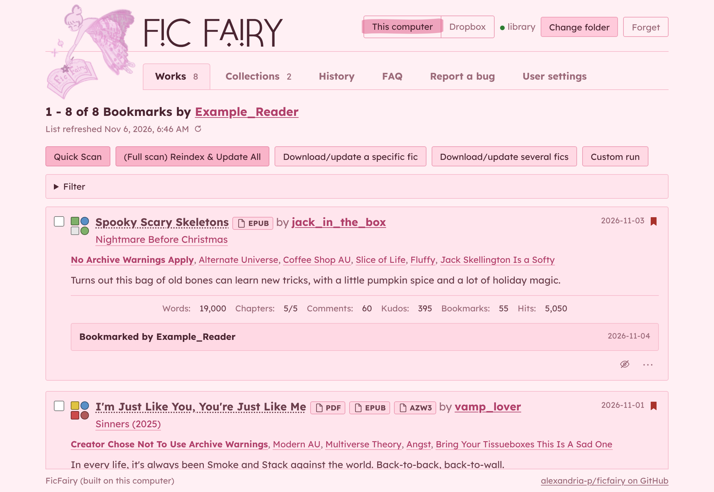
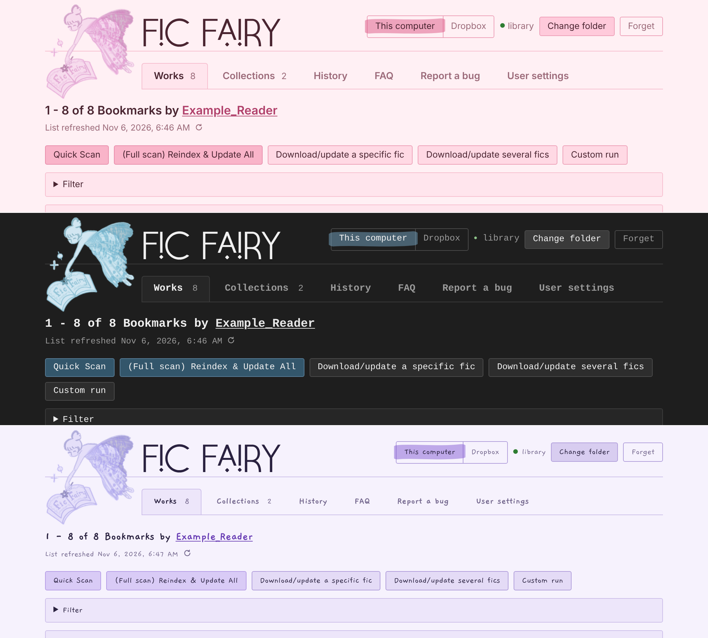
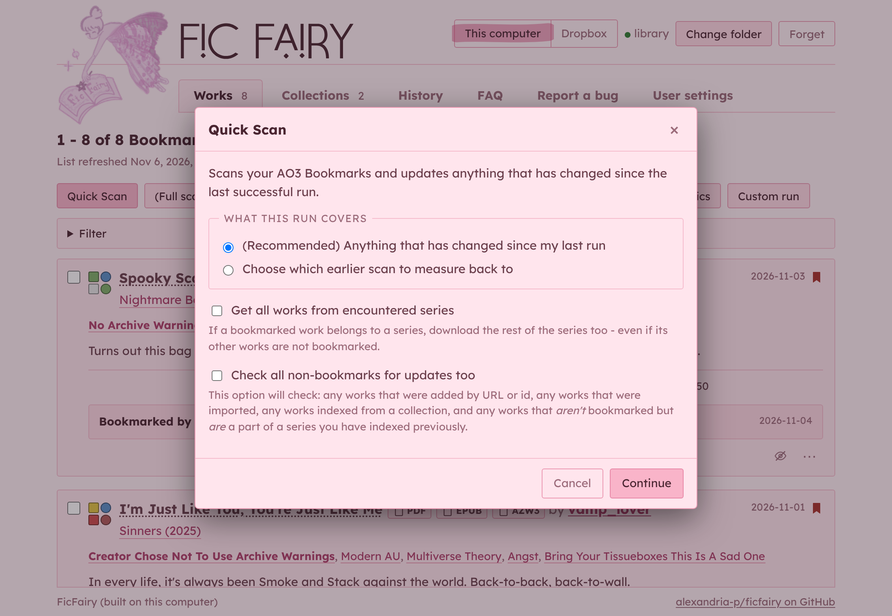
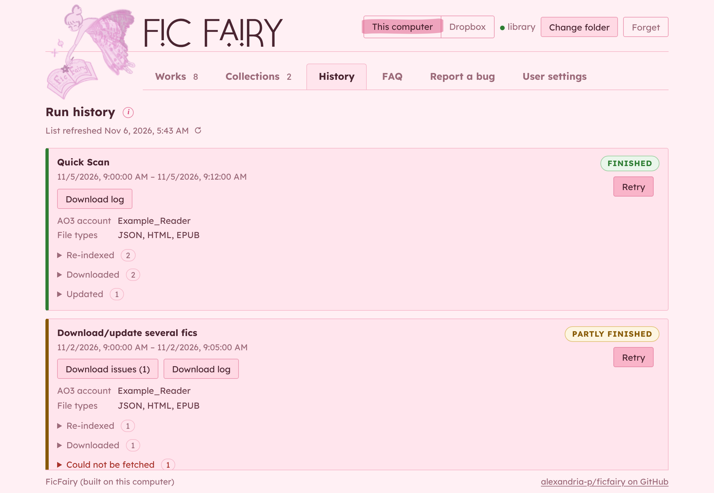
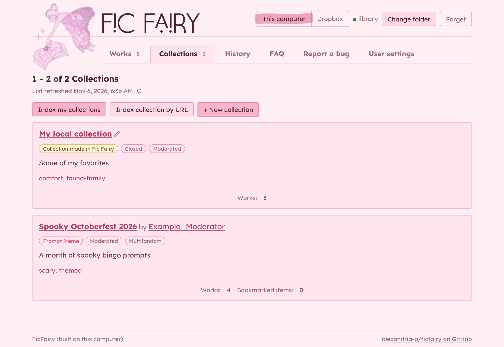
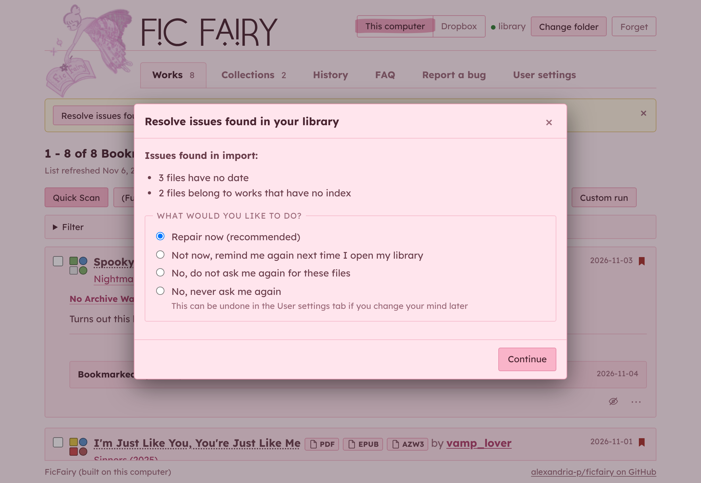

# FicFairy ଘ( ･ω･)_/ﾟ･:*:･｡☆ [![Downloads][downloads-badge]][latest-release]

Keep your own copy of your AO3 bookmarks and collections on your computer or Dropbox.

**This app works best in Chrome web browser.**

𓍊𓋼𓍊𖡼.𖤣𖥧𖡼.𖤣𖥧𓋼𓍊𓋼

## What it does

- **Choose which formats to download.** Download works as HTML, EPUB, PDF, MOBI or AZW3.
- **A Quick Scan fetches only what has changed since your last run**, instead of your whole
  library again.
- **Import a library you already have.** Point it at any fics you downloaded before to import them
  into your library.
- **Browse and search your library in the browser**, and open downloaded works in a new tab.
- **Logging in is optional.** Skip it to fetch only what anyone can see, or log in to access your private bookmarks and fics restricted to AO3 users. Your ao3 login is never saved, and is passed straight to ao3.
- **Keep your fics in your Dropbox** so you can access your downloads from any device - sync up your bookmarks on your computer, and read fic on the go from your phone using Dropbox.

## Download

| Windows | Mac (Apple silicon) | Mac (Intel) | Linux |
| --- | --- | --- | --- |
| [ficfairy-ao3downloader-windows.zip](https://github.com/alexandria-p/ficfairy/releases/latest/download/ficfairy-ao3downloader-windows.zip) | [ficfairy-ao3downloader-macos-apple-silicon.zip](https://github.com/alexandria-p/ficfairy/releases/latest/download/ficfairy-ao3downloader-macos-apple-silicon.zip) | [ficfairy-ao3downloader-macos-intel.zip](https://github.com/alexandria-p/ficfairy/releases/latest/download/ficfairy-ao3downloader-macos-intel.zip) | [ficfairy-ao3downloader-linux-x86_64.zip](https://github.com/alexandria-p/ficfairy/releases/latest/download/ficfairy-ao3downloader-linux-x86_64.zip) |

Unzip it, then start it:

- **Windows:** double-click `ficfairy.exe`.
- **Mac:** double-click `Start FicFairy.command`.
- **Linux:** run `Start FicFairy.sh`.

Blocked on first start? See `README.txt` in the zip.

Every version is on the [releases page](https://github.com/alexandria-p/ficfairy/releases/latest). There is no mobile release for now, but I would eventually like to make a solution that is more portable.

. ݁₊ ⊹ . ݁ ⟡ ݁ . ⊹ ₊ ݁.

## About me, and how I keep FicFairy ethical

I'm a senior software engineer from Australia, and I have been employed and programming professionally for a decade. I started building this project for myself while I was sick in bed in the months before the Great Outage(™️) of 2026, because I wanted to access fic offline on-the-go with Dropbox integration.

The intent is not to 'scrape' ao3 or contribute to any large Google Drives I know are floating round. This is just for personal use to access your own bookmarks and favorite fics. It uses ao3's own built-in download system that they maintain and offer (P.S. - this is why the HTML downloads look the way they do!)

This tool also rests between requests, so as not to overwhelm ao3. As a result, downloading a user's entire bookmark collection can takes upwards of 10 hours to complete. This is the same as if you were manually opening each page and hitting the 'download' button - this tool just does that for you.

- The only thing this tool is built to do is read your user bookmarks, page by page, for your favorite fics.
- If you have the fic IDs or URLs of individual fics, you can also download them that way too.
- It does not read, search, download or scrape the wider ao3 in bulk, and you cannot make it do so either. That is not the intent of this tool.

I forked [nianeyna's excellent tool](https://github.com/nianeyna/ao3downloader), because I loved it but I wanted to add more functionality. A web application, so I could kick off runs without having to open command line tools. 'Indexing', so that I could update only what had changed since my last scan, to make my scans smaller and more efficient for ao3. Some little bugs I found that I knew I could fix up.

I do not accept money. This tool has been developed with the intent to keep it free for personal use. Making it a local download for people's computers means I do not have to pay for hosting costs.

## Security

Logging in is optional. If you wish, you do not have to log in at all. Tick “Skip AO3 login” to fetch only what anyone can see on AO3.

If you *do* wish to login to access more works, then this app logs in to ao3 for you the same way your browser would. It opens ao3’s own login page and sends your username and password to archiveofourown.org over an encrypted (HTTPS) connection. 

Because this runs on your machine, it means you don't have to send that request through any server I am hosting - instead, the HTTPS request goes directly from your computer to ao3's site.

**Dropbox**: You can optionally download your fics to Dropbox, instead of a file location on your computer. Once you grant it access, the app creates a folder inside `dropbox/apps` that it saves everything to. This is the **only** location it has access to - it cannot read from, nor write to, any other locations in your Dropbox. All requests are sent directly from your computer to Dropbox servers, using the Dropbox API.

Note: If lots of users opt-into the Dropbox integration (above 500), it may take up to 30 days for Dropbox to review and approve my application and upgrade the approved user-count.

**Privacy**: FicFairy collects no personal information. Read the full [privacy policy](docs/privacy/FicFairy_Privacy-Policy.docx) for more details on how any optional Feedback is logged.

## AI Use and Disclosure

This project has been developed over 3 months, and 100+ hours of (my own) human time. The code has been hand-architected - implementation has been part manual, part AI-assisted. 

What does this mean? As a senior software engineer and architect, I have mapped out and designed every feature, and how every feature works, on paper and in endless lists across my phone and PC. Every new feature I implement, I consider 'happy-paths', edge-cases, usability, UI design on paper prototypes and graceful error-handling.

How is AI involved?
- only in the generation of the application's CODE, to replace what would be my own busy-work
- the tooling I use is a premium subscription that does not train any models on my code (opt-out clause)
- once the app code is finished & bundled, there is no more AI involved. This is where it ends.
- there is no ai tooling within the app - anything you input, any files that pass through it - NONE of it is touched by AI.
- no stories or excerpts have been passed through AI in development of this application.
  
However, I completely understand if this means that FICFAIRY isn't for you. I encourage you to look at [nianeyna's command-line tool instead](https://github.com/nianeyna/ao3downloader), if you're willing to spend a little more time learning how to set it up.

Even though this tool only uses ao3's own download system, and does not pass anything at all through AI, I am still happy to setup a block on fics that users wish for this tool not to access. Please message me or leave an issue on this GitHub repository with an author name and/or fic name(s), and I will set it up for you in good faith. 

Again, this tool is only for personal use and I have been militant in ensuring that creative human works have not, and will not, be passed through AI - neither in the development nor use of this application.

. ݁₊ ⊹ . ݁ ⟡ ݁ . ⊹ ₊ ݁.

### Make it yours

Pick a colour palette and a font in **User settings**.

## Screenshots

## More

- [The wiki](https://github.com/alexandria-p/ficfairy/wiki): how to use each part of the app.
- [Report a bug](https://github.com/alexandria-p/ficfairy/issues), or use the Feedback tab in the app.
- [BlueSky @ficfairy.bsky.social](https://bsky.app/profile/ficfairy.bsky.social)
- [Twitter/X @ficfairy_ao3](https://x.com/ficfairy_ao3)

Title font is [Doomsdays Dragons by GraphicSauce](https://www.fontspace.com/doomsdays-dragons-elegant-business-font-f161455)  (Freeware, Non-Commercial) 
Forked from [nianeyna/ao3downloader](https://github.com/nianeyna/ao3downloader)

Logo drawn by me using Procreate on my iPad.

. ݁₊ ⊹ . ݁ ⟡ ݁ . ⊹ ₊ ݁.

Developed under the GNU GENERAL PUBLIC LICENSE. This work is, and should remain, free to use. 

Do not copy, modify or transform this work into any service you plan to charge money for. If you do fork this, please link back to this repository and [nianeyna's](https://github.com/nianeyna/ao3downloader), to credit any work that has been used.

Do not repost this work with the intent to pass it off as your own, and do not use this work in any software for profit or with the intent to harm users. You have been warned 🫵🫵🫵

𓍊𓋼𓍊𖡼.𖤣𖥧𖡼.𖤣𖥧𓋼𓍊𓋼

<!-- the download badge: the fairy logo is embedded in the address, so it lives down here -->
[downloads-badge]: https://img.shields.io/github/downloads/alexandria-p/ficfairy/total?style=for-the-badge&logo=data%3Aimage%2Fpng%3Bbase64%2CiVBORw0KGgoAAAANSUhEUgAAABwAAAAcCAMAAABF0y%2BmAAAAwFBMVEX1zPHgrNPhq9PgptHvy%2Bbv0ejz0eoqACp%2FAH%2B5f6i%2Bha%2B7ha3Uf7jHl7%2FwluEAAADwyOb31e7%2F%2F%2F%2Fotdvmq9fXpcr%2B5Pr%2Ff%2F%2F%2Fqv%2Fnt9rwvOL%2Fv%2F9%2Ff3%2BqqqrVls3nuNrtxeL%2FAP%2Fuyea%2Ff7%2FVncfZpMz%2FqqrruN3wxuXxyObWlsTYqM3jqNbiqdT%2Fv7%2Fnu9ruxePYmcjcq9HlltDlqtfnutv%2F19e%2Fv7%2FMlbzQm8PTlsPapsvbs9blr9jkuNjnwd5ECd5YAAAAQHRSTlMWptZUVvGrBgI%2Boe0SIBEA%2B%2FsB%2Ff36%2FgIDSf0EAgMM0LQBMwTzjANzj8csbhkuBDJ3zy4NlBUGBBdSkRkPUI9RH0W5LgAAAcJJREFUeNptkody4zAMROl6uboARFXbao57r%2BnJ%2F%2F%2FVgZKSmdwFEocjPi5ArGjQRIjfD%2FgnTDMPBW1eYVR%2FjMfT6E4%2BIPBAQS7XkWA6%2FawUuc%2BY%2BbVZXL9MWq3V06iGW6yCgIP8Pj4%2Bo9PyPWvbtt0o77BiIuoRs9e2nq9x6%2FvLpuY0ajH3KODEJuSRp8i3jw2MUDI7nfWsQrYKD41ShgV2xx5n5FVBmvmQ1jWlGnGve2qTajWsvU1RnVbSeSmDMfeBF3LU6oZHjJ0yREp7wRtfJCoyolq4LIYKp%2BiaX2sYihGFsklIH4V%2FoDAMy0Vf5MJ7DJwbM%2B03sWQn6rPB0MzLAfI%2BjEIJU2LtheiA2vgrsOPv36p2BeqG1qVJDcPQSJezRT5T5aCYqRna6UQiha5JTIjV%2BYWrG1MVHU1jQmz28x8%2FPZeMOdWmM1czyUqIQawa8t1m9jjGM2I1P%2FEW3IV5okAVlUzHHNsROmTPNC8NzMYt6vHdP%2BGATnorcD7r8d807Y64YbTI83yjbgpOEcYXbaXjJPpms%2FX7D%2FqY3YGcanajC5E0rKipGVU0hmyH%2BP9SD3CkV1wL4AuodLl%2Bz%2Fc5%2FgLKCUAfO27fFgAAAABJRU5ErkJggg%3D%3D&color=e3a3d6&labelColor=2f2238
[latest-release]: https://github.com/alexandria-p/ficfairy/releases/latest
